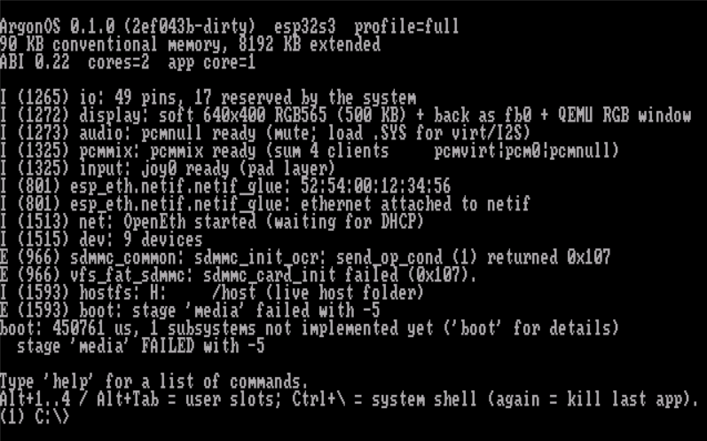
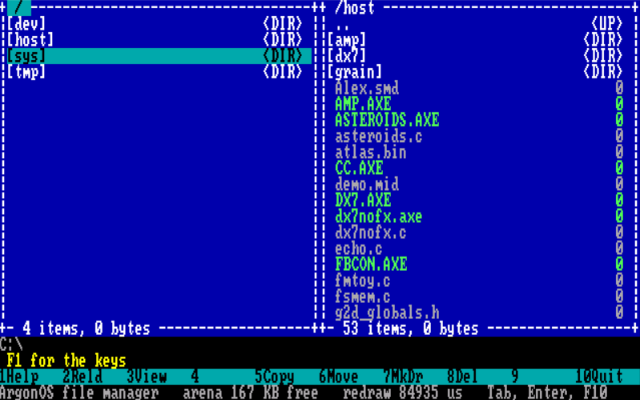
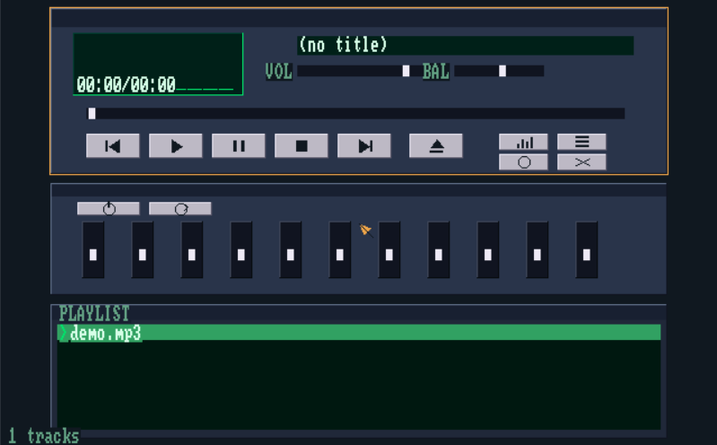
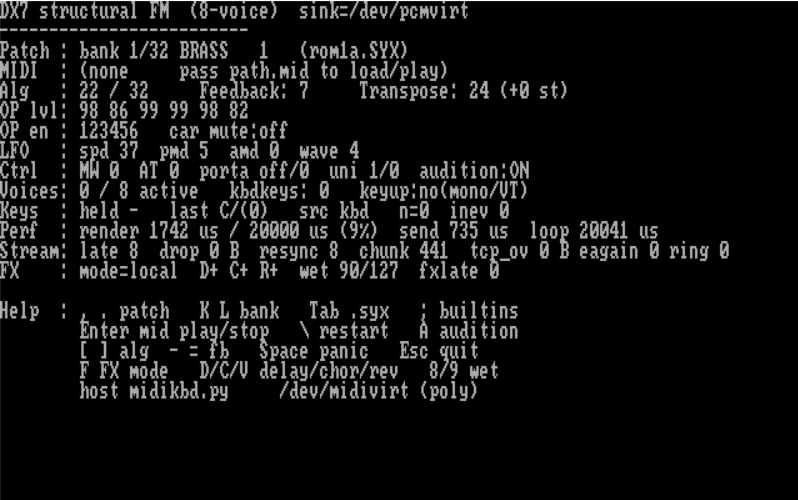

# ArgonOS

**English** | [Русский](README.ru.md)

A small, fast, DOS-style operating system for ESP32 boards. It runs native
applications from an SD card, drives a screen, a keyboard and a mouse, plays
sound, speaks Wi-Fi, and fits on boards that cost a few dollars.

> This operating system was written entirely using AI.

ArgonOS follows the MS-DOS execution model — **the application owns the
machine** — and adds what makes that usable in a real product: a stable ABI for
third-party binaries, a device and driver model, per-process resource
accounting, and a supervisor that can kill a hung application without
rebooting the board.

It is not a Linux clone. There is no MMU-backed process isolation, no virtual
memory, no POSIX layer: a thin kernel, a syscall table, and your code running
on its own task and core with almost all of the RAM.

## Screenshots

<p align="center">
  
</p>

<p align="center">
  
</p>

<p align="center">
  
  &nbsp;
  
</p>

## Try it

* **No board at all:** the whole system boots in Espressif's QEMU —
  `argon run`. See [docs/building.md](docs/building.md#no-board-qemu).
* **A board you already have:** pick it in the table below and follow its
  steps in [docs/building.md](docs/building.md).
* **Without building anything:** the
  [Releases page](https://github.com/yamaxgucci/esp32-os/releases) has a
  ready-to-flash image for the ESP32 "cheap yellow display" (CYD). One
  `esptool` command, no toolchain.

## What it can do

**The system**

* **Processes.** An application is a native image (`.AXE`) loaded from SD or
  from the board's own flash into its own task. Code goes to the executable
  arena, constants and data to PSRAM (or to flash through XIP for big code).
  A hung program can be stopped from the keyboard; one that dereferences a null
  pointer is stopped by itself with the offset in its own code written down; one
  that promises a heartbeat and stops sending it is ended by its watchdog; and
  every byte it took comes back. Crash records survive the reboot. Without an MMU
  a wild pointer can still corrupt memory that is not the application's — a
  deliberate trade.
* **Devices are files.** `/dev` is a registry with classes, owners and exclusive
  access; pins, interrupts, I2C, SPI, UART and PWM are reachable directly, with
  one rule: you may not take what something else is using, and everything you
  took comes back when your process ends. Drivers are linked in or loaded from
  `.SYS` modules at boot.
* **DOS-style drives.** `C:` is the board's own flash (littlefs), `A:` the SD
  card (FAT), `T:` a RAM disk. A dual-pane file manager (`fm`) is built in.
* **A graphical shell.** `DESKTOP.AXE` is a Windows 3.11-style desktop: windows,
  folders, a mouse. It is an ordinary loadable program, not part of the firmware.
  See [docs/user/05-desktop.md](docs/user/05-desktop.md).
* **A compiler on the board.** *Argon CC* turns a small C subset into native
  `.AXE` programs and `.SYS` drivers on the device, with no host toolchain —
  see [apps/cc/README.md](apps/cc/README.md).
* **Network.** Wi-Fi, `net`, `wget`, `httpd` and `ftp` are commands of the
  system, with HTTP and FTP clients and servers. See
  [docs/user/04-network.md](docs/user/04-network.md).
* **A cluster.** Boards wired together by UART or SPI become one machine: run a
  program on the neighbour, use its screen, speaker and card as your own. See
  [docs/user/07-cluster.md](docs/user/07-cluster.md).
* **A phone as screen and keyboard.** A phone joins the board's Wi-Fi and gets
  its display and input in the browser ([apps/phone](apps/phone/README.md)).
* **A USB KVM dongle.** Plugged into a PC, the board is a keyboard, a mouse
  and a flash drive for it; a phone drives it
  ([apps/kvm](apps/kvm/README.md)).
* **An app store.** Programs can be installed from the ArgonOS app shop
  instead of copying files by hand.

**Things that run on it**

| | |
|---|---|
| Mega Drive / Genesis emulator | [docs/user/08-mega-drive.md](docs/user/08-mega-drive.md) |
| Master System emulator | [apps/sms](apps/sms/README.md) |
| Game Boy emulator | `apps/gb` |
| Fallout 1 and 2 (the engine is built from upstream plus our patches, not shipped) | [apps/fallout](apps/fallout/README.md) |
| Valve guitar-amplifier emulator (`STOMP`), cabinet impulse responses | [apps/stomp](apps/stomp/README.md) |
| Winamp-style MP3 player (`AMP`) | [apps/amp](apps/amp/README.md) |
| Six-operator FM synthesiser (`DX7`) | [apps/dx7](apps/dx7/README.md) |
| ESP32-Marauder as a loadable program | [apps/marauder](apps/marauder/README.md) |
| Archiver, editor, HTTP server, and a few dozen test and bench programs | `apps/` |

Some of these are further along than others. The current state of everything —
what works, what does not, and the traps already found — is in
[docs/05-status.md](docs/05-status.md) (in Russian).

## Supported boards

| Board | Chip | Screen | Build target | Notes |
|---|---|---|---|---|
| ESP32-S3-WROOM CAM clone (N16R8) | ESP32-S3 | ST7789 on SPI | `esp32s3-board` | The main development board. Fallout 2, Mega Drive, USB. |
| ESP32-2432S028R / S024 "CYD" | ESP32 | ILI9341 320×240, touch | `esp32-cyd` | No PSRAM. Mega Drive, Master System. Release image available. |
| Waveshare ESP32-S3-Touch-LCD-2 | ESP32-S3 | ST7789, touch | `esp32s3-lcd2` | 16 MB flash, 8 MB PSRAM. |
| Waveshare ESP32-S3-Zero | ESP32-S3 | none | `esp32s3-zero` | 4 MB flash, I2S DAC. Cluster node. |
| Waveshare ESP32-C6-LCD-1.47 | ESP32-C6 (RISC-V) | ST7789 172×320 | `esp32c6` | Wi-Fi 6 and BLE. Console over USB. |
| ESP32-C3 SuperMini | ESP32-C3 (RISC-V) | none | `esp32c3` | One core. A cluster node. |
| M5Stack Stamp-P4 | ESP32-P4 (RISC-V ×2) | none | `esp32p4` | 32 MB PSRAM, no radio. |
| AI-Thinker ESP32-A1S Audio Kit | ESP32 | none | `esp32-a1s` | ES8388 codec; the guitar-pedal board. |
| LilyGo T-Dongle-S3 / S3-CAM as a KVM | ESP32-S3 | ST7735S / ST7789 | `esp32s3-kvm` | USB keyboard, mouse and drive for another PC. |

Step-by-step instructions for each: **[docs/building.md](docs/building.md)**.
Setting up a board that is not on the list:
[docs/user/02-board-setup.md](docs/user/02-board-setup.md) (Russian).

The S3 needs 8 or 16 MB of PSRAM. A **32 MB** PSRAM module does not work: the
S3 maps flash and PSRAM through one 32 MB window, and at 32 MB the partition
table stops being visible.

## Design in one screen

```
  Applications (.AXE)   native code, loaded from SD, runs on a task of its own
  ─────────────────────────────────────────────────────────────────
  libargon              inline wrappers over a versioned syscall table
  ─────────────────────────────────────────────────────────────────
  ArgonOS kernel        loader · processes · memory arenas · VFS
                        console multiplexer · device manager · shell
                        supervisor (watchdog, Ctrl-Alt-Del, recovery)
  ─────────────────────────────────────────────────────────────────
  board pack            BOARD.CFG: pins, buses, display, SD mode
  ─────────────────────────────────────────────────────────────────
  ESP-IDF               FreeRTOS · drivers · Wi-Fi · USB · lwIP
```

Applications are relocatable native images: no interpreter, no JIT, no
sandbox — native speed after load. The console is a virtual text screen
rendered at once to UART, telnet and a local display, so one build works
headless or with a screen and a keyboard. Graphics are opt-in: text by
default, and an application can take the display and draw, like a DOS video
mode switch.

## Building

Everything goes through one entry point, `argon.cmd` (a batch file, so it
works on a stock Windows install where `.ps1` scripts are disabled):

```
argon target esp32-cyd        pick the board (rebuilds from scratch)
argon build                   build the firmware
argon flash -port COM5        flash it and open the monitor
argon run                     run in QEMU instead of a board
argon tests                   host unit tests, no hardware needed
argon check                   host tests + firmware + every application
```

You need Windows, ESP-IDF 5.5 and Python 3. The full walk-through, with the
exact commands for every board, is in **[docs/building.md](docs/building.md)**.

Writing an application? Start with
[docs/sdk/01-getting-started.md](docs/sdk/01-getting-started.md); the rest of
the contract is in [02-api-reference.md](docs/sdk/02-api-reference.md),
[03-application-anatomy.md](docs/sdk/03-application-anatomy.md),
[04-axe-format.md](docs/sdk/04-axe-format.md) and
[05-drivers.md](docs/sdk/05-drivers.md). Using the machine rather than
programming it: [docs/user/01-shell.md](docs/user/01-shell.md). The design
notes and the SDK documents are in Russian.

Why the design is what it is: [docs/00-architecture.md](docs/00-architecture.md).
What comes next: [docs/04-roadmap.md](docs/04-roadmap.md).

## License

Split licensing — details in [LICENSING.md](LICENSING.md):

- **Kernel** (`components/argon_kernel/`, `main/`) and host-tests: **GPL-3.0-or-later** ([LICENSE](LICENSE))
- **SDK** (`sdk/`), tools, and most apps: **Apache-2.0** ([LICENSE.Apache-2.0](LICENSE.Apache-2.0))
- **The valve amplifier emulator** (`apps/common/tube/`, `apps/common/ckt/`,
  `apps/cktbench/`, `apps/tubebench/`, `tools/tube_render.c`,
  `tools/tube_live.c`): **PolyForm-Noncommercial-1.0.0**
  ([LICENSE.PolyForm-Noncommercial-1.0.0](LICENSE.PolyForm-Noncommercial-1.0.0)) —
  use and modify it freely for anything that is not commercial; selling it needs a
  separate licence
- Third-party trees keep their own licenses

Applications that only use the public syscall ABI are not required to be GPL.
