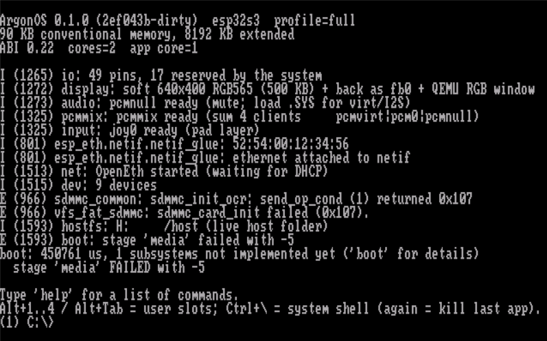
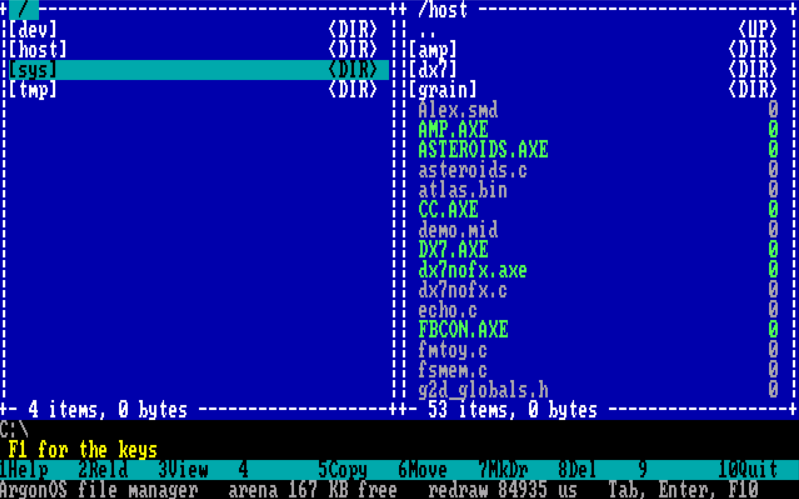
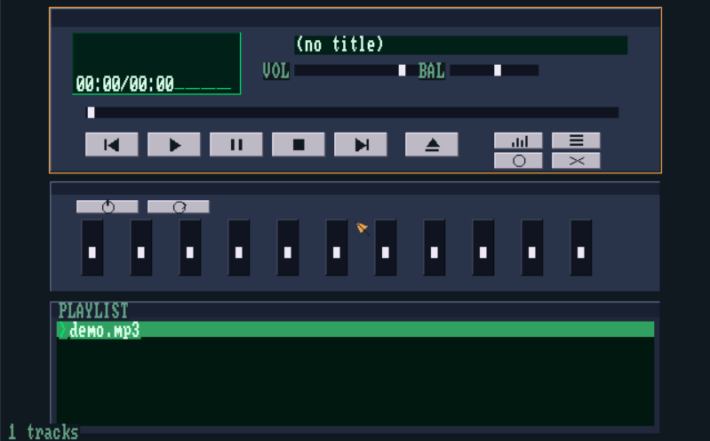
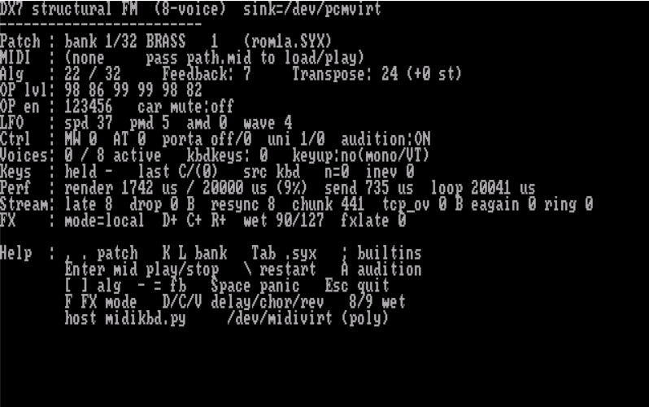

# ArgonOS

[English](README.md) | **Русский**

Небольшая быстрая ОС в стиле DOS для плат на ESP32. Запускает родные приложения
с SD-карты, работает с экраном, клавиатурой и мышью, играет звук, умеет Wi-Fi и
помещается на платы за несколько долларов.

> Эта операционная система целиком написана с помощью ИИ.

ArgonOS следует модели исполнения MS-DOS — **приложение владеет машиной** — и
добавляет то, без чего это нельзя пустить в изделие: стабильный ABI для чужих
бинарников, модель устройств и драйверов, учёт ресурсов по процессам и
супервизор, который снимает зависшую программу без перезагрузки платы.

Это не клон Linux. Нет защиты памяти на MMU, нет виртуальной памяти, нет слоя
POSIX: тонкое ядро, таблица системных вызовов и ваш код в собственной задаче, на
своём ядре, почти со всей оперативной памятью.

## Снимки экрана

<p align="center">
  
</p>

<p align="center">
  
</p>

<p align="center">
  
  &nbsp;
  
</p>

## Попробовать

* **Совсем без платы:** вся система грузится в QEMU от Espressif — `argon run`.
  См. [docs/building.ru.md](docs/building.ru.md#без-платы-qemu).
* **Плата, которая у вас есть:** найдите её в таблице ниже и пройдите шаги из
  [docs/building.ru.md](docs/building.ru.md).
* **Ничего не собирая:** на странице
  [Releases](https://github.com/yamaxgucci/esp32-os/releases) лежит готовый образ
  для ESP32 «cheap yellow display» (CYD). Одна команда `esptool`, тулчейн не нужен.

## Что умеет

**Система**

* **Процессы.** Приложение — родной образ (`.AXE`), он грузится с SD или из
  собственной flash платы в свою задачу. Код — в исполняемую арену, константы и
  данные — в PSRAM (большой код — прямо из flash через XIP). Зависшую программу
  можно остановить с клавиатуры; обратившуюся по нулевому указателю система
  останавливает сама и записывает смещение в её коде; обещавшую «сердцебиение» и
  замолчавшую — снимает её сторожевой таймер; каждый взятый байт возвращается.
  Записи о падениях переживают перезагрузку. Без MMU неверный указатель всё ещё
  может испортить чужую память — это сознательный размен.
* **Устройства — это файлы.** `/dev` — реестр с классами, владельцами и
  монопольным доступом; выводы, прерывания, I2C, SPI, UART и ШИМ доступны
  напрямую при одном правиле: нельзя занимать то, чем пользуется другой, а всё
  взятое возвращается, когда процесс умирает. Драйверы вкомпилированы или
  грузятся из модулей `.SYS` при старте.
* **Диски в духе DOS.** `C:` — собственная flash платы (littlefs), `A:` — SD-карта
  (FAT), `T:` — RAM-диск. Двухпанельный файловый менеджер (`fm`) встроен.
* **Графическая оболочка.** `DESKTOP.AXE` — рабочий стол в стиле Windows 3.11:
  окна, папки, мышь. Обычная загружаемая программа, не часть прошивки. См.
  [docs/user/05-desktop.md](docs/user/05-desktop.md).
* **Компилятор на плате.** *Argon CC* превращает подмножество C в родные
  программы `.AXE` и драйверы `.SYS` прямо на устройстве, без тулчейна на
  компьютере — [apps/cc/README.md](apps/cc/README.md).
* **Сеть.** Wi-Fi, `net`, `wget`, `httpd` и `ftp` — команды системы, клиенты и
  серверы HTTP и FTP. См. [docs/user/04-network.md](docs/user/04-network.md).
* **Кластер.** Платы, соединённые по UART или SPI, становятся одной машиной:
  программу можно запустить на соседе, а его экран, динамик и карта работают как
  свои. См. [docs/user/07-cluster.md](docs/user/07-cluster.md).
* **Телефон как экран и клавиатура.** Телефон входит в Wi-Fi платы и получает её
  дисплей и ввод в браузере ([apps/phone](apps/phone/README.md)).
* **USB-KVM-свисток.** Воткнутая в компьютер плата — для него клавиатура, мышь и
  флешка; управляется с телефона ([apps/kvm](apps/kvm/README.md)).
* **Магазин приложений.** Программы можно ставить из магазина ArgonOS, а не
  копировать руками.

**Что на ней запускается**

| | |
|---|---|
| Эмулятор Mega Drive / Genesis: от магазина до сборки из исходников | [docs/mega-drive.ru.md](docs/mega-drive.ru.md) |
| Настоящий джойстик Sega (3 или 6 кнопок) через PCF8574 | [docs/sega-pad.ru.md](docs/sega-pad.ru.md) |
| Эмулятор Master System | [apps/sms](apps/sms/README.md) |
| Эмулятор Game Boy | `apps/gb` |
| Fallout 1 и 2 (движок собирается из оригинала с нашими патчами, в репозитории его нет) | [apps/fallout](apps/fallout/README.md) |
| Эмулятор ламповых гитарных усилителей (`STOMP`), импульсы кабинетов | [apps/stomp](apps/stomp/README.md) |
| MP3-плеер в духе Winamp (`AMP`) | [apps/amp](apps/amp/README.md) |
| Шестиоператорный FM-синтезатор (`DX7`) | [apps/dx7](apps/dx7/README.md) |
| ESP32-Marauder как загружаемая программа | [apps/marauder](apps/marauder/README.md) |
| Архиватор, редактор, HTTP-сервер и несколько десятков тестовых программ | `apps/` |

Что-то из этого продвинулось дальше, что-то меньше. Актуальное состояние всего —
что работает, что нет и на какие грабли уже наступили — в
[docs/05-status.md](docs/05-status.md).

## Поддерживаемые платы

| Плата | Чип | Экран | Цель сборки | Примечания |
|---|---|---|---|---|
| ESP32-S3-WROOM CAM, клон (N16R8) | ESP32-S3 | ST7789 по SPI | `esp32s3-board` | Основная плата разработки. Fallout 2, Mega Drive, USB. |
| ESP32-2432S028R / S024 «CYD» | ESP32 | ILI9341 320×240, тач | `esp32-cyd` | Без PSRAM. Mega Drive, Master System. Есть готовый образ. |
| Waveshare ESP32-S3-Touch-LCD-2 | ESP32-S3 | ST7789, тач | `esp32s3-lcd2` | 16 МБ flash, 8 МБ PSRAM. |
| Waveshare ESP32-S3-Zero | ESP32-S3 | нет | `esp32s3-zero` | 4 МБ flash, I2S ЦАП. Узел кластера. |
| Waveshare ESP32-C6-LCD-1.47 | ESP32-C6 (RISC-V) | ST7789 172×320 | `esp32c6` | Wi-Fi 6 и BLE. Консоль по USB. |
| ESP32-C3 SuperMini | ESP32-C3 (RISC-V) | нет | `esp32c3` | Одно ядро. Узел кластера. |
| M5Stack Stamp-P4 | ESP32-P4 (RISC-V ×2) | нет | `esp32p4` | 32 МБ PSRAM, без радио. |
| AI-Thinker ESP32-A1S Audio Kit | ESP32 | нет | `esp32-a1s` | Кодек ES8388; плата гитарной педали. |
| LilyGo T-Dongle-S3 / S3-CAM как KVM | ESP32-S3 | ST7735S / ST7789 | `esp32s3-kvm` | USB-клавиатура, мышь и диск для другого ПК. |

Пошаговые инструкции для каждой: **[docs/building.ru.md](docs/building.ru.md)**.
Как поднять плату, которой нет в списке:
[docs/user/02-board-setup.md](docs/user/02-board-setup.md).

Для S3 нужно 8 или 16 МБ PSRAM. Модуль с **32 МБ** PSRAM не работает: S3
отображает flash и PSRAM через одно окно в 32 МБ, и на 32 МБ таблица разделов
перестаёт быть видна.

## Устройство в одном экране

```
  Приложения (.AXE)     родной код, грузится с SD, работает в своей задаче
  ─────────────────────────────────────────────────────────────────
  libargon              inline-обёртки над версионированной таблицей вызовов
  ─────────────────────────────────────────────────────────────────
  ядро ArgonOS          загрузчик · процессы · арены памяти · VFS
                        мультиплексор консоли · менеджер устройств · shell
                        супервизор (watchdog, Ctrl-Alt-Del, восстановление)
  ─────────────────────────────────────────────────────────────────
  пакет платы           BOARD.CFG: выводы, шины, дисплей, режим SD
  ─────────────────────────────────────────────────────────────────
  ESP-IDF               FreeRTOS · драйверы · Wi-Fi · USB · lwIP
```

Приложения — перемещаемые родные образы: без интерпретатора, без JIT, без
песочницы — после загрузки скорость нативная. Консоль — виртуальный текстовый
экран, который одновременно выводится в UART, telnet и на локальный дисплей, так
что одна сборка работает и без экрана, и с экраном и клавиатурой. Графика
включается по желанию: по умолчанию текст, приложение может забрать дисплей и
рисовать — как переключение видеорежима в DOS.

## Сборка

Всё идёт через одну точку входа, `argon.cmd` (это батник, чтобы работать на
обычной Windows, где скрипты `.ps1` по умолчанию запрещены):

```
argon target esp32-cyd        выбрать плату (пересборка с нуля)
argon build                   собрать прошивку
argon flash -port COM5        прошить и открыть монитор
argon run                     запустить в QEMU вместо платы
argon tests                   юнит-тесты на ПК, плата не нужна
argon check                   тесты + прошивка + все приложения
```

Нужны Windows, ESP-IDF 5.5 и Python 3. Полный разбор с точными командами для
каждой платы — **[docs/building.ru.md](docs/building.ru.md)**.

Пишете приложение? Начните с
[docs/sdk/01-getting-started.md](docs/sdk/01-getting-started.md); остальной
контракт — [02-api-reference.md](docs/sdk/02-api-reference.md),
[03-application-anatomy.md](docs/sdk/03-application-anatomy.md),
[04-axe-format.md](docs/sdk/04-axe-format.md),
[05-drivers.md](docs/sdk/05-drivers.md). Пользоваться машиной, а не
программировать её: [docs/user/01-shell.md](docs/user/01-shell.md).

Почему устройство такое: [docs/00-architecture.md](docs/00-architecture.md). Что
дальше: [docs/04-roadmap.md](docs/04-roadmap.md).

## Лицензия

Лицензирование разделено, подробности — в [LICENSING.md](LICENSING.md):

- **Ядро** (`components/argon_kernel/`, `main/`) и host-tests: **GPL-3.0-or-later** ([LICENSE](LICENSE))
- **SDK** (`sdk/`), инструменты и большинство приложений: **Apache-2.0** ([LICENSE.Apache-2.0](LICENSE.Apache-2.0))
- **Эмулятор лампового усилителя** (`apps/common/tube/`, `apps/common/ckt/`,
  `apps/cktbench/`, `apps/tubebench/`, `tools/tube_render.c`,
  `tools/tube_live.c`): **PolyForm-Noncommercial-1.0.0**
  ([LICENSE.PolyForm-Noncommercial-1.0.0](LICENSE.PolyForm-Noncommercial-1.0.0)) —
  свободно использовать и менять можно для всего, что не коммерческое; продавать
  его можно только по отдельной лицензии
- Сторонние деревья сохраняют свои лицензии

Приложения, которые используют только публичный ABI системных вызовов, не обязаны
быть GPL.
